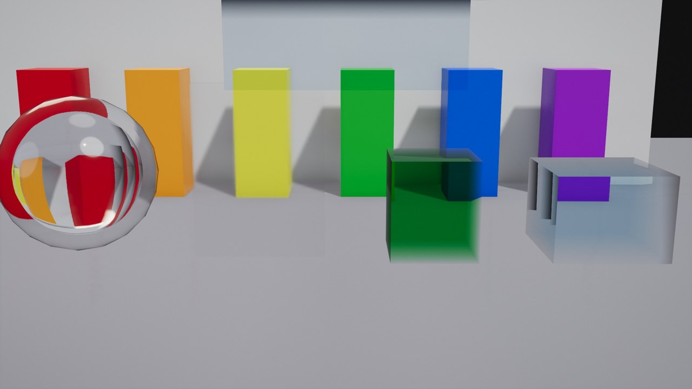
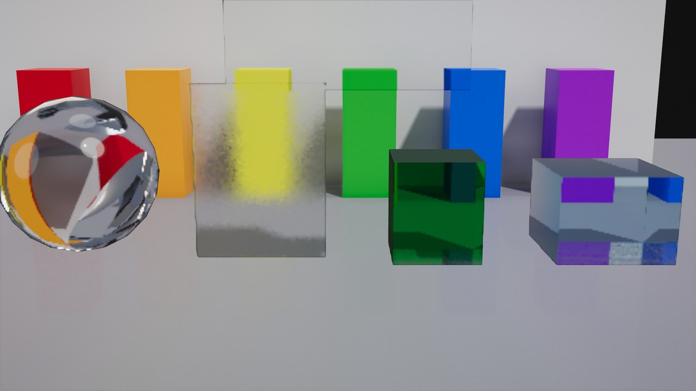
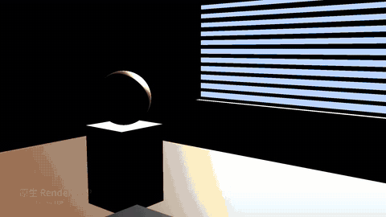
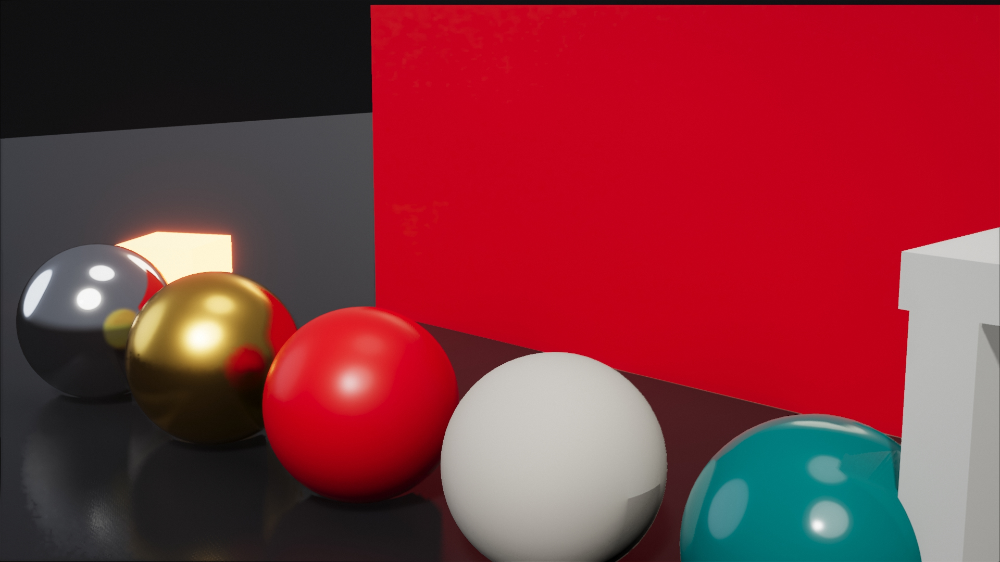

# BetterTDRender (BTDR)

A single TouchDesigner operator, `renderBTDR`, that renders like Unreal Engine 5's defaults:
a deferred pipeline with PBR (native PBR MAT), soft shadows, studio / HDRI image-based lighting,
TAA, bloom, auto exposure, depth of field, motion blur, screen-space AO / bounce light / reflections,
volumetric fog, hardware ray tracing (probe GI + traced reflections, a simplified Lumen), and transparency:
- **refraction** (0.6.0): glass, water, ice, gems and frosted glass with measured thickness, absorption and Fresnel
  (drag a Geometry COMP into a Refractive slot, or just give its PBR MAT an alpha below 1);
- **ray-traced refraction** (0.7.0): Refraction Method = Hybrid or Ray Traced traces through the glass with hardware
  ray tracing — glass behind glass, objects off screen, total internal reflection.




[](docs/media/btdr_intro.mp4)

**[▶ Watch the 60-second intro video](docs/media/btdr_intro.mp4)** (v0.7.3) — native Render TOP vs BTDR, parameters the native renderer doesn't have (volumetric fog, probe GI, ray-traced refraction, depth of field), screen-space reflections, volumetric light, 400 k Chladni-figure particles and a material showcase, all rendered in TouchDesigner. Music generated for the edit.



Current build: **0.7.0** (M6a screen-space refraction + M6c ray-traced refraction; design in [docs/M6_TRANSPARENCY.md](docs/M6_TRANSPARENCY.md)). Branch `release/v0.1.0` = first snapshot (internal build 0.5.0).

## Quick start

1. Make a Camera COMP `cam1`, a Distant Light COMP and a Geometry COMP with a PBR MAT.
2. Drop `release/BTDR.tox` into the same network.
3. Connect its output to a Null TOP. No parameters to fill in.

Or drop `release/BTDR_Example.tox` in and view its `OUT`.

Requirements: TouchDesigner 2025.33230+, Windows, RTX 4060 Laptop recommended (RTX 2060 minimum, Quality = Low).
Ray tracing needs an RTX 20 series or newer card and switches itself off otherwise.

## Docs (Chinese)

| File | For |
|---|---|
| [docs/USER_GUIDE.md](docs/USER_GUIDE.md) | Users: quick start, every parameter, performance tips |
| [docs/IMPLEMENTATION.md](docs/IMPLEMENTATION.md) · [1b](docs/IMPLEMENTATION_1b.md) | Maintainers: structure, anchors `[BTDR:XXX]`, every pass (§0–§9e) |
| [docs/IMPLEMENTATION_2.md](docs/IMPLEMENTATION_2.md) | Maintainers: performance, pitfalls, tests, developer workflow, changelog (§10–§13) |

## Layout

```
build.py        builds release/BTDR.tox from shaders/ and ext/ (sources are files, the .tox is a product)
shaders/        GLSL (common.glsl is prepended; *.comp are compute shaders)
ext/            Python extension, uniforms Script CHOP callbacks
tests/          m1_tests.py (39 regression checks), m5_acceptance.py (7 acceptance checks)
examples/       demo_scene.py (dev scene), make_example.py (BTDR_Example.tox), make_showcase.py (4-preset showcase project), hdri/ (CC0)
tools/          perf_bench, cpu_profile, ab_compare (picture A/B of two builds), hotswap, make_release, ...
release/        BTDR.tox, BTDR_Example.tox
```

All scripts run inside TouchDesigner's Textport with the project folder as the parent of this folder
(`project.folder + '/btdr/...'`); see IMPLEMENTATION_2.md §11c.

## Status and contributing

Developed and measured on one machine (RTX 5080 Laptop, 1080p: about 2 ms GPU at Quality = High).
Other GPUs, and the automatic fallback on cards without ray tracing, are not tested yet —
issues with your GPU model, TouchDesigner build and a screenshot are very welcome.
Known gaps (single directional light, no transparency, no object motion vectors, …) are listed in
docs/IMPLEMENTATION_2.md §12.

## License

[PolyForm Noncommercial 1.0.0](LICENSE) © 2026 Xikai Lei. Source-available, **not for commercial use**.
Personal, study, research, artistic and other noncommercial use is free. If you pass the software (or a modified copy) on,
keep the `Required Notice:` line from `LICENSE`, i.e. credit *BetterTDRender by Xikai Lei* and link this repository.
Please also credit it in works you show that were made with it. For commercial use, contact the author.

`examples/hdri/kloofendal_43d_clear_2k.hdr` — Poly Haven, CC0 (not covered by the BetterTDRender license; see [THIRD_PARTY_NOTICES.md](THIRD_PARTY_NOTICES.md)).
